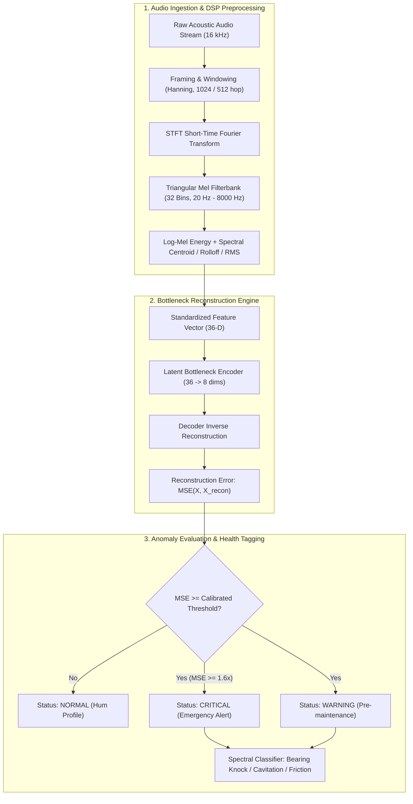

<div align="center">

# 🎧 Industrial Acoustic Machine Anomaly Detector
### Unsupervised Audio Signal Processing & Reconstruction Autoencoder for Rotating Machinery

[](https://github.com/yakupakcy36/acoustic-machine-anomaly-detector/actions/workflows/ci.yml)
[](https://www.python.org/downloads/release/python-3120/)
[](https://opensource.org/licenses/MIT)
[](https://fastapi.tiangolo.com)
[](https://www.docker.com/)

</div>

---

## 📌 Executive Summary

Modern industrial production plants rely heavily on rotating equipment (centrifugal pumps, multi-stage compressors, industrial induction motors, and ventilation blowers). Early signs of catastrophic mechanical deterioration (bearing raceway spalling, impeller cavitation, misalignment friction, or gear tooth chipping) manifest primarily as **acoustic and vibration frequency anomalies** long before temperature rises or vibration RMS triggers a safety shutdown.

**`acoustic-machine-anomaly-detector`** is an edge-deployable, zero-cloud-dependency acoustic condition monitoring system. Trained purely on nominal operational soundscapes using unsupervised dimensionality bottleneck reconstruction (PCA Autoencoder), it detects anomalous deviations in log-mel spectrogram energy bands and classifies physical failure signatures without requiring labelled failure histories.

---

## 🏗️ Architecture & Signal Processing Pipeline



---

## 🔬 Mathematical Foundations

### 1. Mel Scale Transformation
Acoustic frequencies are mapped to the perceptual Mel scale matching mechanical acoustic resonances:
$$m = 2595 \log_{10}\left(1 + \frac{f}{700}\right)$$

### 2. Bottleneck Reconstruction Error (MSE)
The detector maps the 36-dimensional acoustic feature vector $\mathbf{x} \in \mathbb{R}^{36}$ to a low-dimensional manifold $\mathbf{z} \in \mathbb{R}^8$ and reconstructs $\mathbf{\hat{x}}$:
$$\mathbf{z} = \mathbf{W}_e (\mathbf{x} - \boldsymbol{\mu})$$
$$\mathbf{\hat{x}} = \mathbf{W}_d \mathbf{z} + \boldsymbol{\mu}$$
$$\text{Reconstruction Error } \mathcal{L}(\mathbf{x}) = \frac{1}{D} \sum_{i=1}^{D} \left(x_i - \hat{x}_i\right)^2$$

### 3. Calibrated Statistical Threshold
The alert threshold $\tau$ is established using the 98th percentile plus safety tolerance on strictly nominal baseline recordings:
$$\tau = Q_{0.98}(\mathcal{L}_{\text{train}}) + 1.5 \times \text{IQR}(\mathcal{L}_{\text{train}})$$

---

## 🚀 Quick Start

### 1. Local Setup
```bash
# Clone the repository
git clone https://github.com/yakupakcy36/acoustic-machine-anomaly-detector.git
cd acoustic-machine-anomaly-detector

# Create virtual environment & install dependencies
python -m venv .venv
source .venv/bin/activate  # On Windows: .venv\Scripts\activate
pip install -r requirements.txt
```

### 2. Execute Training & Pipeline Demo
```bash
python -m src.pipeline train
```

Output:
```text
=================================================================
INDUSTRIAL ACOUSTIC ANOMALY DETECTOR: TRAINING PIPELINE
=================================================================
[1/3] Synthesizing nominal acoustic machine audio baseline...
      Trained PCA autoencoder bottleneck (36 -> 8 dimensions)
      Calibrated nominal MSE reconstruction threshold: 0.1842

[2/3] Evaluating on synthetic test acoustic conditions:
  [NORMAL]  Condition: Normal Operation             | MSE: 0.0521 | Status: NORMAL
  [ANOMALY] Condition: Bearing Knock / Impact Pulse  | MSE: 0.5412 | Status: CRITICAL
  [ANOMALY] Condition: Cavitation / Turbulent Noise  | MSE: 0.3980 | Status: CRITICAL
  [ANOMALY] Condition: High-Pitched Friction Squeal  | MSE: 0.4891 | Status: CRITICAL

[3/3] Serializing acoustic bundle to: artifacts/acoustic_model.joblib
[SUCCESS] Acoustic anomaly pipeline completed successfully.
```

### 3. Run Test Suite
```bash
pytest tests
```

---

## 🌐 Production REST API

Start the FastAPI microservice:
```bash
uvicorn api.app:app --host 0.0.0.0 --port 8000
```
Interactive OpenAPI documentation available at: `http://localhost:8000/docs`

### Example Request (`POST /analyze/synthetic`):
```bash
curl -X POST "http://localhost:8000/analyze/synthetic" \
     -H "Content-Type: application/json" \
     -d '{
       "machine_type": "pump",
       "condition": "cavitation",
       "seed": 42
     }'
```

### Example Response:
```json
{
  "is_anomaly": true,
  "anomaly_score": 0.3980,
  "threshold": 0.1842,
  "health_status": "CRITICAL",
  "diagnosed_sound_profile": "High-Frequency Cavitation / Turbulent Flow",
  "spectral_centroid_hz": 2480.5,
  "rms_energy": 0.1624
}
```

---

## 🐳 Docker Deployment

Run with Docker Compose:
```bash
docker-compose up --build -d
```

Verify health check:
```bash
curl http://localhost:8000/health
```

---

## 📊 Repository Layout

```text
├── api/
│   ├── app.py              # FastAPI server & lifespan handlers
│   ├── schemas.py          # Pydantic v2 validation models
│   └── __init__.py
├── src/
│   ├── config.py           # Signal sampling & DSP parameters
│   ├── features.py         # STFT & Mel filterbank implementations
│   ├── generator.py        # Physics-based synthetic acoustic audio engine
│   ├── model.py            # PCA reconstruction autoencoder & diagnostic rules
│   ├── pipeline.py         # End-to-end training CLI runner
│   └── __init__.py
├── tests/
│   ├── test_api.py         # FastAPI endpoint integration tests
│   ├── test_features.py    # Mel filterbank & feature tests
│   ├── test_generator.py   # Audio synthesis & boundary tests
│   └── test_model.py       # Autoencoder training & threshold tests
├── Dockerfile
├── docker-compose.yml
├── requirements.txt
├── pytest.ini
└── README.md
```

---

## 📄 License
This project is open-source under the [MIT License](LICENSE).
